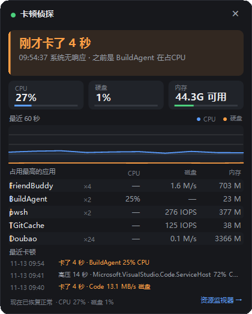
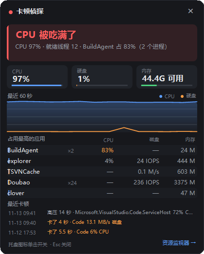
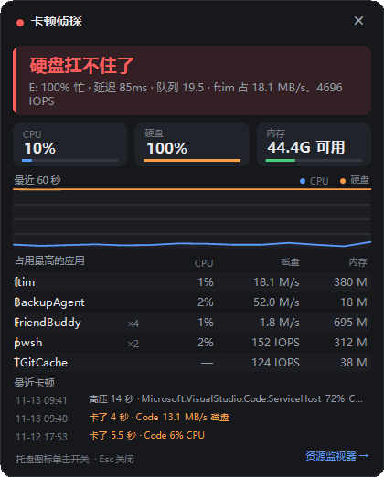

# LagLens

A tiny Windows tray app for the moment your PC suddenly stutters. Click the tray icon and it tells you **who** is hogging the machine and **whether the CPU or the disk** is the bottleneck.



[中文](README.md) · **English**

## Why another monitor?

The hard part of diagnosing a stutter is not the data, it's the **timing**:

- The spike is usually over by the time Task Manager opens.
- Task Manager does not show disk latency or queue depth; Resource Monitor does, but you have to dig for it and interpret it yourself. An NVMe drive at 100% utilization with 1ms latency feels fine; a spinning disk at 100% with 80ms latency makes the mouse stutter.
- Paging, drivers and antivirus scanning happen in kernel mode, so Task Manager cannot attribute them to an app.

So LagLens samples every second, keeps the last 60 seconds in memory, and records the moment the system froze. Open it after the stutter and you see "it froze for 4 seconds, and BuildAgent was eating the CPU", not "everything looks fine now".

## Features

- **One-line verdict**: `Disk can't keep up` / `CPU is maxed out` / `Running out of memory` / `Everything looks smooth`
- **Three live metrics**: CPU usage, busiest physical disk utilization, available memory
- **60-second chart** for CPU and disk utilization
- **Top 5 apps** aggregated by process name, so `Code ×12` counts all 12 processes together
- **The tray icon is the status**: green = fine, orange = busy, red = struggling; it **stays red while an incident is unread**
- **No popups, ever**: it never steals focus, it only changes the tray color
- **Automatic incident log**: freezes and sustained high pressure are written to disk; the panel shows the latest three
- **Start with Windows**, plus a shortcut to Resource Monitor

## Screenshots

After a freeze, opening the panel shows how long it lasted and who was responsible (see the screenshot above). Two typical bottlenecks:

<p align="center">
  
  
</p>

The three tray states:


> BuildAgent / BackupAgent and the 4-second freeze in the screenshots are demo scenarios staged for the docs. Every number in the panel is real sampled data.

## How the verdict is made

| Verdict | Trigger (any of) |
| --- | --- |
| Disk can't keep up | average disk latency ≥ 25ms, or disk queue ≥ 4 |
| CPU is maxed out | total CPU ≥ 80% |
| Running out of memory | available memory < max(900MB, 4% of RAM), or commit ratio ≥ 95% |

If several thresholds are crossed, the one furthest past its threshold becomes the headline. CPU ≥ 55%, disk latency ≥ 10ms or queue ≥ 2 shows an orange warning but does not count as an incident.

**Freeze detection**: if the gap between two samples exceeds 2.5 seconds (and is under 120 seconds, so sleep is not counted), it records a freeze with its duration and the process that was busiest right before it.

**High-pressure log**: if any metric stays in the "struggling" state for 5 seconds or more, one record is written when the episode ends, with the peak value and the culprit.

### Why latency instead of MB/s

- At the same 100% utilization, 1ms on NVMe and 80ms on a hard drive feel completely different.
- A pile of 4K random writes may only reach 20MB/s, yet push a hard drive's queue to 20 and freeze the desktop.
- So the primary signal is `Avg. Disk sec/Transfer`, with queue depth as a second signal. `% Disk Time` is shown but not trusted on its own.

### Why not Pages/sec for memory

`Pages/sec` includes file cache activity and can spike into the thousands on a mostly idle 32GB machine. LagLens uses **available memory + commit ratio** instead.

## Usage

1. Double-click `LagLens.exe`; the icon appears in the notification area.
2. Left click: toggle the panel; `Esc` or `×` closes it.
3. Right click: open panel / start with Windows / open Resource Monitor / exit.

Opening the panel marks incidents as read and the icon returns to its normal color. No administrator rights required. Windows 10 / 11 x64.

Autostart is a per-user value at `HKCU\Software\Microsoft\Windows\CurrentVersion\Run\LagLens`; unchecking the menu item removes it.

### Command line

```text
LagLens.exe --show              open the panel on startup
LagLens.exe --probe             sample for 8s, write raw data to %TEMP%\laglens-probe.txt
LagLens.exe --shot <png path>   sample for 15s, then render the panel to PNG (docs)
```

## Incident log

Records live in `%LOCALAPPDATA%\LagLens\incidents.json`, capped at 200 entries and kept across restarts.

| Field | Meaning |
| --- | --- |
| `Kind` | `冻结` (freeze) / `高压` (sustained pressure) |
| `Seconds` | duration |
| `Culprit` | busiest process name at the time |
| `Resource` | `CPU` / `磁盘` (disk) / `内存` (memory) |
| `Peak` | culprit's peak value (percent / MB/s / MB) |
| `Cpu` / `DiskBusy` / `DiskLatencyMs` | system peaks during the episode |

## Build

Requires the .NET 10 SDK:

```powershell
dotnet build -c Release

# self-contained single file (~100MB, no .NET needed on the target machine)
dotnet publish -c Release -r win-x64 --self-contained true -p:PublishSingleFile=true -o publish

# framework-dependent (much smaller, requires the .NET 10 Desktop Runtime)
dotnet publish -c Release -r win-x64 --self-contained false -p:PublishSingleFile=true -o publish
```

## Known limitations

- Kernel-mode work (paging, drivers, Defender scanning) is attributed to `System`, not to the app that caused it. This is a Windows boundary.
- Per-process disk I/O comes from `GetProcessIoCounters` and **includes network I/O**, so downloaders and cloud drives look busier than they are; IOPS also counts cache hits.
- If a driver or GPU truly hangs, LagLens freezes along with the rest of the system. Once it recovers, it shows how long the freeze lasted.
- Sleep longer than 120 seconds is ignored; a short sleep (e.g. 30 seconds of lid-closed) may be recorded as one freeze.
- No per-process GPU breakdown yet; disk latency is only trusted when utilization is at least 30%.
- The exe is unsigned, so SmartScreen may warn on first launch.
- The UI strings are currently Chinese-only; the screenshots show the Chinese interface.

## Overhead

Measured on an i9-11900K (16 threads): about **0.2% total CPU** (roughly 3% of one core) and **~90MB** of memory. The main cost is enumerating all processes once per second.

## Privacy

Everything stays in local memory and `%LOCALAPPDATA%\LagLens\`. No network access, no uploads.

---

[中文 README](README.md)
