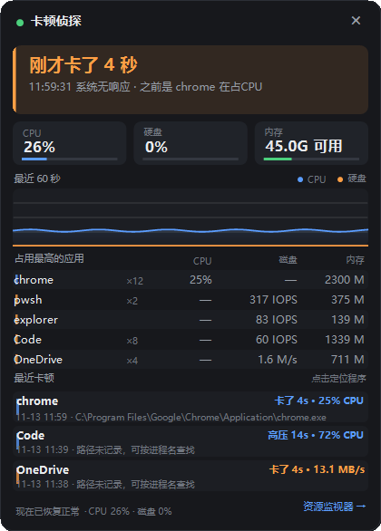
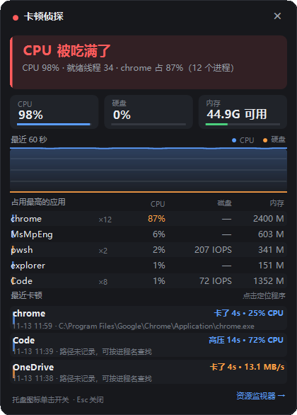
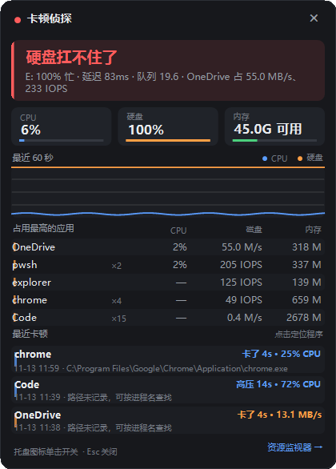

# 卡顿侦探 · LagLens

常驻 Windows 托盘的小工具。电脑突然卡的时候点一下托盘图标，直接告诉你**是谁**在吃资源、**是 CPU 还是硬盘**扛不住了。



**中文** · [English](README.en.md)

## 为什么要做这个

卡顿最难查的地方不是数据不够，而是**时机**：

- 卡的那一两秒，等你打开任务管理器，峰值往往已经过去了。
- 任务管理器不显示磁盘延迟和队列；资源监视器虽然有，但要一层层找，还得自己判断。NVMe 盘 100% 忙但延迟只有 1ms 时桌面依然顺滑；机械盘同样 100% 忙，延迟 80ms，就会卡到鼠标都飘。
- 内核态的换页、驱动、杀毒软件底层扫描，任务管理器归不到具体进程。

所以 LagLens 的做法是：**每秒采样、在内存里保留最近 60 秒、把卡死的那一刻单独记下来**。卡完再点开，看到的是“刚才卡了几秒、当时是谁干的”，而不是“现在一切正常”。

## 功能

- **一句话结论**：`硬盘扛不住了` / `CPU 被吃满了` / `内存不够用了` / `当前挺顺畅`
- **三个实时指标**：CPU 占用、最忙物理盘的忙碌度、可用内存
- **最近 60 秒曲线**：CPU 与磁盘忙碌度
- **占用最高的 5 个应用**：按进程名聚合，`Code ×12` 表示 12 个进程合计算
- **托盘图标即状态**：绿=顺畅，橙=偏高，红=顶不住；**有卡顿记录还没看时保持红色**
- **全程不弹窗**：不打断工作，只在托盘上换颜色
- **自动记录**：卡死和持续高压都会落盘，面板底部显示最近 3 条
- **一键定位**：点击任意一条卡顿记录，直接在资源管理器中打开元凶程序所在目录并选中它
- **开机自启**，右键可一键打开资源监视器

## 界面

卡死之后打开面板，会直接显示刚才卡了几秒、当时是谁在占资源（见顶部截图）。另外两个典型场景：

<p align="center">
  
  
</p>

托盘图标的三种状态：


> 截图使用模拟数据演示冻结、CPU 高占用和磁盘繁忙场景。软件名称及路径均为常见软件的示例，不包含真实使用记录或本机路径。

## 判定逻辑

| 结论 | 触发条件（满足任一） |
| --- | --- |
| 硬盘扛不住了 | 磁盘平均延迟 ≥ 25ms，或磁盘队列 ≥ 4 |
| CPU 被吃满了 | 总 CPU ≥ 80% |
| 内存不够用了 | 可用内存 < max(900MB, 总内存 4%)，或提交率 ≥ 95% |

同时超标时，取“超出阈值倍数”最大的那个作为主因。CPU ≥ 55%、磁盘延迟 ≥ 10ms、队列 ≥ 2 时显示橙色告警，但不记卡顿。

**冻结检测**：两次采样的间隔超过 2.5 秒（且不超过 120 秒，避免把休眠算进去），就记一条冻结事件，记录停顿时长和冻结前占资源最多的进程。

**高压记录**：任一指标进入“扛不住”状态并持续 5 秒以上，结束时记一条，保留峰值和元凶。

### 为什么硬盘看延迟，不看 MB/s

- 同样是 100% 忙碌度，NVMe 延迟 1ms、机械盘延迟 80ms，体感完全不同。
- 大量 4K 随机写可能只有 20MB/s，却能把机械盘队列堆到 20，桌面直接卡住。
- 所以主判据是 `Avg. Disk sec/Transfer`（平均延迟），辅以队列长度；`% Disk Time` 只用于展示和辅助判断。

### 为什么内存不看 Pages/sec

`Pages/sec` 把文件缓存也算了进去，32GB 空闲时也能飙到几千，容易误报。这里改用**可用内存 + 提交率**。

## 使用

1. 双击 `LagLens.exe`，图标出现在右下角托盘。
2. 左键单击：开/关面板；`Esc` 或右上角 `×` 关闭。
3. 右键菜单：打开面板 / 开机自动启动 / 打开资源监视器 / 退出。

点开面板即视为“已读”，托盘图标恢复常态。不需要管理员权限，Windows 10 / 11 x64 均可运行。

开机自启写在 `HKCU\Software\Microsoft\Windows\CurrentVersion\Run\LagLens`，取消勾选会删除该项，只影响当前用户。

### 命令行

```text
LagLens.exe --show              启动时直接打开面板
LagLens.exe --probe             采 8 秒，把原始数据写到 %TEMP%\laglens-probe.txt
LagLens.exe --shot <png 路径>   采 15 秒后把面板渲染成 PNG（文档截图用）
```

## 卡顿记录

记录保存在 `%LOCALAPPDATA%\LagLens\incidents.json`，保留最近 200 条，重启后仍在。

面板底部显示最近 3 条：第一行是程序名和持续时间/峰值，第二行是发生时间和 exe 路径。点击任意一条会用 `explorer /select` 打开程序所在目录并选中该 exe；如果记录里没有路径（旧版本记录），会按进程名去当前运行的进程里查找。

| 字段 | 含义 |
| --- | --- |
| `Kind` | `冻结` / `高压` |
| `Seconds` | 持续秒数 |
| `Culprit` | 当时占资源最多的进程名 |
| `CulpritPath` | 元凶 exe 的完整路径，用于点击定位 |
| `Resource` | `CPU` / `磁盘` / `内存` |
| `Peak` | 元凶的峰值（百分比 / MB/s / MB） |
| `Cpu` / `DiskBusy` / `DiskLatencyMs` | 事件期间的系统峰值 |

## 构建

需要 .NET 10 SDK：

```powershell
dotnet build -c Release

# 自包含单文件（约 100MB，目标机不用装 .NET）
dotnet publish -c Release -r win-x64 --self-contained true -p:PublishSingleFile=true -o publish

# 依赖已安装的 .NET 10 桌面运行时（体积小很多）
dotnet publish -c Release -r win-x64 --self-contained false -p:PublishSingleFile=true -o publish
```

## 已知局限

- 内核态活动（换页、驱动、Defender 底层扫描）会算在 `System` 进程头上，归不到具体应用，这是 Windows 的固有边界。
- 进程磁盘 IO 来自 `GetProcessIoCounters`，**包含网络 IO**，下载/网盘进程的磁盘数字会偏高；IOPS 也包含命中缓存的读写。
- 真正的驱动/GPU 硬挂起时，本程序自己也会被冻住；恢复后会显示刚才冻结了多久。
- 休眠/睡眠超过 120 秒不记为卡顿；短睡眠（如合盖 30 秒）可能被误记一次冻结。
- 暂不含 GPU 占用细分；磁盘延迟只在忙碌度 ≥ 30% 时采信。
- 未签名 exe 首次运行会有 SmartScreen 提示，自用选择“仍要运行”即可。

## 开销

实测（i9-11900K / 16 线程）：常驻约 **0.2% 总 CPU**（约 3% 单核）、内存约 **90MB**。主要成本是每秒枚举一次全部进程。

## 数据与隐私

全部数据留在本机内存和 `%LOCALAPPDATA%\LagLens\`，不联网、不上传。

---

[English README](README.en.md)
